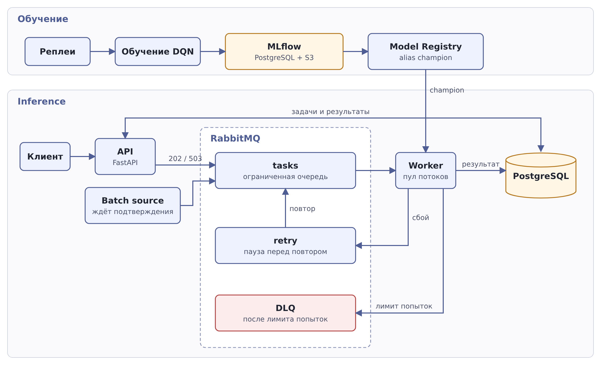

# hexrl-platform

[](https://github.com/mematvey/hexrl-platform/actions/workflows/ci.yml)

Обучение, оценка и запуск RL-агентов в гексагональной среде

Агент учится доходить до цели по гексагональной карте и обходить стены. В последствии добавится возможность получения усилений прямо на карте, а также проведения боев между разными агентами. В проекте есть обучение и оценка, Model Registry и асинхронный inference через очередь с ограничением нагрузки

## Архитектура



- API принимает задачу, сохраняет её в PostgreSQL, ставит в RabbitMQ и сразу отвечает `202`. Если очередь заполнена, отвечает `503` с `Retry-After`
- Worker один раз при старте загружает модель `champion` из Registry и считает ответы в пуле потоков, чтобы не блокировать event loop
- Длина очереди ограничена. Упавшие задачи повторяются, а после лимита попыток попадают в DLQ
- Batch source не шлёт следующую задачу, пока брокер не подтвердил текущую (backpressure)

## Стек

| Область | Технологии |
| --- | --- |
| RL | Gymnasium, Stable-Baselines3, PyTorch |
| Эксперименты | MLflow 3, PostgreSQL, S3 (RustFS) |
| Сервисы | FastAPI, asyncio, SQLAlchemy, asyncpg |
| Очереди | RabbitMQ, FastStream |
| Инфраструктура | Docker, Docker Compose |
| Качество | uv, ruff, ty, pytest, Testcontainers, pre-commit |
| CI/CD | GitHub Actions, GHCR |

## Быстрый старт

Нужны [uv](https://docs.astral.sh/uv/getting-started/) и Docker

```bash
git clone https://github.com/mematvey/hexrl-platform.git && cd hexrl-platform
cp .env.example .env  # задать свои серкеты
uv sync --group experiments --group rl-cpu
docker compose up -d --build mlflow  # http://localhost:5000
```

Чтобы скачивать артефакты MLflow с хоста, добавьте в hosts строку `127.0.0.1 artifact-store`

### Обучение

```bash
uv run hexrl-generate-replays --episodes 1000 --seed 42
uv run hexrl-eda
uv run hexrl-experiment --config configs/navigation-dqn.toml
uv run hexrl-register --config configs/navigation-dqn.toml
```

Для лабиринта есть отдельный конфиг `configs/navigation-dqn-maze.toml`

### Сервисы

```bash
docker compose up -d --build app worker
curl -X POST http://localhost:8000/api/v1/tasks -H "Content-Type: application/json" \
  -d '{"q":0,"r":0,"goal_q":2,"goal_r":-1,"steps_remaining":20}'
curl http://localhost:8000/api/v1/tasks/<task_id>
```

Swagger: `http://localhost:8000/docs`, RabbitMQ: `http://localhost:15672`

## Эксперименты

- DQN сравниваем со случайной политикой и кратчайшим путём
- Задачи делятся на train, validation и test
- В каждый запуск пишутся конфиг, seed, коммит и хеши данных
- `champion` получает модель с лучшим результатом на test

### Результаты на лабиринте

Доля задач, доведённых до цели, на test. 5 seed на каждую политику, среднее и разброс

| Политика | Среднее | Разброс по seed |
| --- | --- | --- |
| Случайная | 0,14 | 0,12-0,17 |
| DQN, exploration 0.1 | 0,74 | 0,70-0,78 |
| DQN, exploration 0.5 | 0,82 | 0,74-0,94 |
| Кратчайший путь | 1,00 | |

DQN намного лучше случайной политики, но до кратчайшего пути не дотягивает. Seed сильно влияет на результат: у exploration 0.5 лучший и худший запуск отличаются на 0,2

`champion` выбирается по test-метрике среди запусков, поэтому его оценка завышена: 0,94 при среднем 0,82. Политики нужно сравнивать по среднему по seed

На простой карте (`configs/navigation-dqn.toml`) DQN во всех запусках доходит до 1,00, там политики не отличаются. Поэтому таблица построена на лабиринте

## Нагрузочные опыты

В каждом опыте 500 задач. Задержка inference 0,5 с на задачу имитирует тяжёлую модель: сам DQN считает за миллисекунды, и без задержки очередь бы не заполнялась. Данные и логи лежат в [`docs/backpressure/results/2026-10-22-release`](docs/backpressure/results/2026-10-22-release), скрипты в [`scripts/backpressure`](scripts/backpressure)

| Опыт | Пик очереди | p95 задержки | Задач в секунду |
| --- | --- | --- | --- |
| A: без лимита, 1 worker | 482 | 112,8 с | 4,2 |
| B: лимит 20, 1 worker | 20 | 6,4 с | 4,1 |
| C: лимит 20, 2 worker | 20 | 3,9 с | 8,3 |
| D: как B, плюс сбои и перезапуски | 22 | 12,9 с | 3,7 |

Лимит очереди сильно снижает задержку, а скорость почти не меняется. Второй worker удваивает скорость. В опыте D ни одна задача не потерялась: 450 завершились, ещё 50 были сломаны намеренно


## Структура

```text
src/hexrl_platform/
  rl/             среда, обучение, оценка, Registry
  api/, service/  HTTP API
  task_pipeline/  очередь, worker, batch source
  inference/      загрузка модели
  db/, core/      база, конфиг, логи
configs/          конфиги экспериментов
scripts/          нагрузочные опыты
docs/             результаты опытов, правила разработки
tests/            тесты
```

## Разработка

Правила веток, коммитов и релизов в [CONTRIBUTING](docs/CONTRIBUTING.md)

```bash
uv sync --group dev --group experiments --group rl-cpu --group inference
uv run pre-commit install
uv run ruff check . && uv run pytest
```
