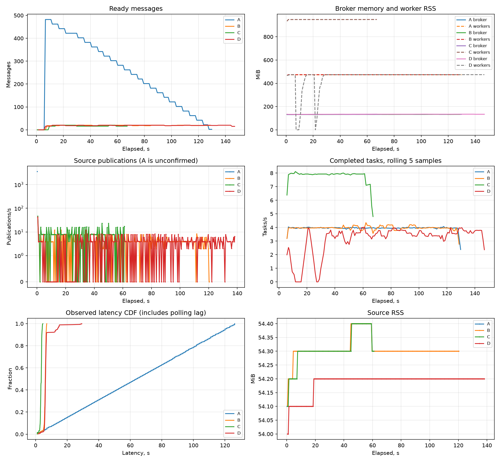
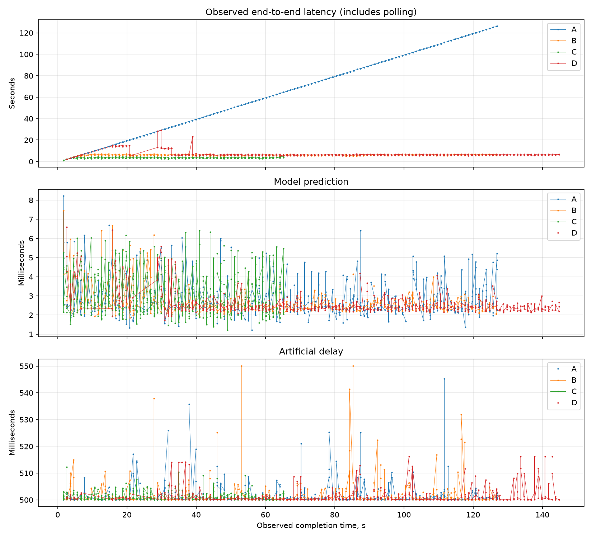
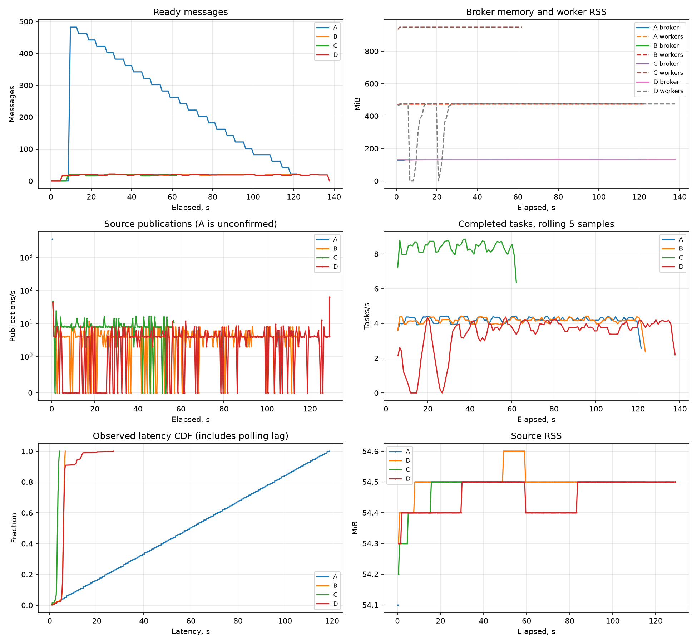

# Асинхронный inference и управление нагрузкой

[Финальная сверка каждого критерия, альтернативы и маршрут защиты](audit.md).

Задача этой работы — отделить приём состояния от расчёта действия, ограничить
накопление работы и проверить поведение при перегрузке и сбоях. Это не игровой
веб-интерфейс: MLflow показывает эксперименты и модели, Swagger — HTTP API,
RabbitMQ Management — очереди. Проигрыватель реплеев в эту работу не входит.

## Поток задачи

```text
JSONL → batch source ───────────────────┐
           ↑ отказ → backoff с jitter   │
HTTP → API → PENDING → confirm ─────────┤
         ↓ отказ: удалить, 503          ▼
                                tasks (classic, publish limit 20)
                                       │ prefetch = 2 на воркер
                                       ▼
                          PROCESSING → пул потоков → модель
                                       │ commit результата
                                       ▼
                              COMPLETED → ack → GET result
                                       │ ошибка
                  retry (quorum, TTL) ←─┤─→ FAILED → DLQ
                           │ confirm   │
                           └──→ tasks ─┘
```

Роутер занимается HTTP-кодами и валидацией, сервис — приёмом и компенсацией,
репозиторий — SQL. Publisher и сессия приходят через зависимости. Подключения
создаются в lifespan, закрываются в обратном порядке даже при неудачном старте.
Воркеры загружают `champion` один раз до запуска consumer. В каждом результате
сохраняются имя и фактически загруженная версия модели, а не текущее значение alias.

Приём через HTTP: создать и закоммитить `PENDING`, дождаться publisher confirm,
условно обновить `PENDING → ACCEPTED`. Условие не позволяет затереть `COMPLETED`,
если быстрый воркер уже успел закончить. При отказе или таймауте удаляется только
`PENDING`: обработанная задача не удаляется. После аварии API старые `PENDING`
убираются при запуске и фоновым заданием. При недоступной БД немедленную очистку
гарантировать нельзя; она ограничена по времени, ошибка логируется, очистка
повторится после восстановления.

Новая колонка `inference_results.model_name` добавляется без удаления таблиц;
у старых результатов она `NULL`, поскольку достоверно восстановить имя нельзя.
DDL нескольких одновременно стартующих API/воркеров сериализуется advisory lock
PostgreSQL. Существующие интерфейсы репозитория сохранены, новые чтение/очистка
добавлены отдельно. Таблица задач сохраняет прежние JSON и timestamps: API
вычисляет время завершения из результата либо `updated_at` для `FAILED`.

## Настройки и их смысл

| Параметр | Значение опытов | Обоснование |
| --- | --- | --- |
| `QUEUE_MAX_LENGTH` | 20 (A: `null`) | Лимит приёма по ready, не включает unacked |
| `WORKER_CONCURRENCY` | 2 | Два потока расчёта на процесс |
| `PREFETCH_COUNT` | 2 | Не забирать больше текущей мощности процесса |
| `INFERENCE_DELAY_S` | 0.5 | Контролируемая имитация дорогого расчёта в потоке |
| `MAX_DELIVERIES` | 3 | Лимит попыток при ошибках inference |
| `RETRY_DELAY_MS` | 1000 | Пауза перед повтором, не busy loop |
| `RETRY_FORWARD_CONFIRM_TIMEOUT_MS` | 1000 | Повтор безопасной пересылки при полной tasks |
| `PUBLISH_CONFIRM_TIMEOUT_S` | 0.5 | Источник не ждёт confirm бесконечно |
| `BACKOFF_BASE_S / BACKOFF_CAP_S` | 0.05 / 1.0 | Экспоненциальный full jitter без синхронных повторов |
| `TASK_SUBMISSION_TIMEOUT_S` | 0.75 | Дедлайн всего приёма, включая БД |
| `TASK_CLEANUP_TIMEOUT_S` | 0.2 | Ограниченное время компенсации после отказа |
| `PENDING_TASK_TTL_S` | 60 | Очистка сирот, не обычных активных запросов |
| `PENDING_CLEANUP_INTERVAL_S` | 30 | Периодическая компенсация после аварии |
| `ESTIMATED_WORKER_COUNT` | 1 | Конфигурационная оценка для HTTP Retry-After |

`Retry-After = max(1, ceil(T / (N × C)))`. Для 0.5 с, одного воркера и двух
потоков получается 0.25 с, но заголовок целочисленный, поэтому `1` секунда.
Это рекомендация, а не обещание свободного места. После масштабирования следует
актуализировать оценку N у API. Management API используется только для измерений,
не для разрешения публикации или вычисления backoff.

Граница HTTP — **load shedding**: клиенту быстро отказывают, а не накапливают
запросы. Внутри batch source — **backpressure**: он не читает следующую строку,
пока текущая не подтверждена; при отказе повторяет ту же запись с тем же UUID.
**Rate limiting** — другой механизм: ограничение числа запросов за интервал,
которого здесь нет. Счётчик глубины очереди не является rate limiter.

## Исправленные стыки

При подготовке обнаружены не только недостающие HTTP-ручки:

1. Classic dead-lettering терял retry при полной tasks. Проверено на реальном
   RabbitMQ. По согласованию retry переведена на quorum, переходы подтверждаются.
2. Lifespan объявлял топологию до подключения брокера. Соединение теперь открывается
   до объявления, обработчики стартуют только после загрузки модели.
3. В FastStream 0.7.7 очередь кэшируется вместе с каналом первого объявления.
   Объявление в lifespan создавало канал с prefetch=0; последующий subscriber с
   `Channel(prefetch_count=2)` не менял уже закэшированную очередь. В пробном опыте
   backlog перемещался внутрь воркера. Теперь один объект Channel с QoS используется
   и как default, и в subscriber. Регрессионный тест блокирует inference:
   из десяти задач восемь должны оставаться ready, только две — в обработке.
4. Внутренние порты контейнеров отделены от опубликованных портов хоста: app=8000,
   PostgreSQL=5432, RabbitMQ=5672. Иначе отдельный стенд с портами 18000/25432/25672
   пытался подключаться внутри сети Docker по портам хоста.
5. Доработаны чтение результата, очистка PENDING, сохранение имени модели и запуск
   источника через `python -m`. Неудачные предварительные запуски не подменяют
   итоговые измерения; отчёт ссылается только на каталог проверенных опытов.

## Подтверждения и безопасные повторы

Основная очередь остаётся classic с `reject-publish`. Retry-очередь использует quorum,
TTL и `x-dead-letter-strategy=at-least-once`: истёкшее сообщение хранится до подтверждения
основной очередью. Тип DLQ — classic. В одноузловом Docker Compose quorum не даёт
отказоустойчивости целого кластера; здесь он нужен для подтверждаемой пересылки.

При временной ошибке inference воркер:

1. Сохраняет номер попытки и ошибку в БД, делает commit.
2. Публикует копию сообщения в retry с publisher confirms и следующим `x-attempt`.
3. Только после подтверждения приёма подтверждает исходное сообщение.
4. После TTL брокер пересылает задачу обратно. Если основная очередь полна,
   сообщение остаётся в retry и пересылка повторяется.

Один лишь `reject` из classic-очереди не гарантировал бы доставку в retry. Одной
лишь замены retry на quorum поэтому недостаточно: подтверждаются оба перехода.
Таймаут confirm оставляет исход неопределённым и может привести к дублю. Ключ
`inference_results.task_id` сохраняет только один результат для одной задачи.

При третьей неудаче inference задача получает `FAILED`, сообщение публикуется в
DLQ с подтверждением, затем исходная доставка подтверждается. Постоянная ошибка
состояния отправляется в DLQ сразу. `x-attempt` переживает пересылки и перезапуски;
`x-death` читается как запасной счётчик для сообщений прежней реализации.

Если отправка в retry не подтвердилась, новая доставка original сохраняет старый
заголовок. Счётчик неудач дополнительно восстанавливается из БД, поэтому бюджет
не сбрасывается. Повтор уже FAILED-задачи не вызывает модель: он повторяет только
публикацию в DLQ с причиной `previously_failed`. Уникальный результат остаётся
неизменным, счётчик attempts не уменьшается из-за запоздалой доставки.

При недоступности БД обработчик сохраняет исходную доставку через `nack(requeue=True)`
с паузой. Это восстановление инфраструктуры, а не ограниченные попытки inference:
`MAX_DELIVERIES` не ограничивает длительность недоступности БД. Нельзя одновременно
обещать запись `FAILED` в недоступную БД и подтверждать сообщение до восстановления.

## Настройки

`RETRY_DELAY_MS=5000` задаёт задержку первой повторной обработки. Это не период
повторной пересылки при полной очереди. Для последнего отдельно задаётся
`RETRY_FORWARD_CONFIRM_TIMEOUT_MS=1000` в окружении RabbitMQ. Без явной настройки
брокер использует 180000 мс, что заметно задерживает восстановление после перегрузки.
Compose передаёт значение через `RABBITMQ_SERVER_ADDITIONAL_ERL_ARGS`.

## Обновление существующих очередей

RabbitMQ не меняет тип уже существующей очереди с classic на quorum. При повторном
объявлении старой retry-очереди запуск завершится с `PRECONDITION_FAILED`.

Для перехода остановить источники, дождаться обработки старых задач, проверить
ready, unacked и retry, затем выбрать новый общий `QUEUE_PREFIX` для API, batch source
и всех воркеров. Старые очереди и тома автоматически не удаляются. Если в старых
очередях остались задачи, сначала нужно завершить их обработку или перенести с
подтверждением; простая смена префикса их не перенесёт.

## Проверка

Обычные проверки выполняются без Docker:

```bash
uv run --no-sync pytest
```

Реальный RabbitMQ той же версии, что в Compose, поднимается через Testcontainers:

```bash
uv run --no-sync pytest -m integration tests/integration
```

Проверяются возврат истёкшего сообщения после освобождения полной очереди и три
последовательные ошибки настоящего обработчика с последующим переходом в DLQ.
Во втором тесте модель намеренно бросает исключение; это проверка доставки,
а не качества обученной политики. Интеграционные тесты запускаются отдельным шагом CI.

## Воспроизведение на отдельном стенде

Требуются Docker Desktop с Linux-контейнерами, Python 3.12+ и uv. Команды выполняются
из корня репозитория. Стенд использует отдельное имя Compose-проекта, собственные
volumes и порты, чтобы не затронуть существующие эксперименты. Это локальные
учебные сервисы, не защищённое публичное развёртывание.

Ниже PowerShell; `dc` — только сокращение полной команды Compose. В bash можно
выполнять те же аргументы после полной команды `docker compose -p hexrl-hw4
--env-file .env.hw4 -f docker-compose.yaml -f scripts/backpressure/compose.benchmark.yaml`.

```powershell
uv sync --frozen --group experiments --group rl-cpu --group inference
Copy-Item scripts/backpressure/benchmark.env.example .env.hw4
# Установить свои пароли и ключи в .env.hw4 до первого запуска.
function dc {
    docker compose -p hexrl-hw4 --env-file .env.hw4 -f docker-compose.yaml -f scripts/backpressure/compose.benchmark.yaml @args
}
dc build app worker
dc up -d --build db rabbitmq mlflow
dc ps
```

Приложение: `http://127.0.0.1:18000/docs`, MLflow: `http://127.0.0.1:15000`,
RabbitMQ Management: `http://127.0.0.1:25673`. Доступ к RabbitMQ — с реквизитами
из своего `.env.hw4`. PostgreSQL опубликован только на loopback:25432 для измерителя.
При занятом порту изменить соответствующее значение шаблона до запуска.

### Подготовка настоящей модели и данных

Если подходящая модель уже зарегистрирована, обучение повторять не требуется.
Для нового, изолированного сервера:

```powershell
dc run --rm --no-deps worker hexrl-generate-replays --episodes 1000 --seed 42
dc run --rm --no-deps worker hexrl-experiment --config configs/navigation-dqn-smoke.toml
dc run --rm --no-deps worker hexrl-register --config configs/navigation-dqn-smoke.toml
```

Smoke-конфиг обучает два DQN по 3000 шагов и нужен здесь для получения реальной
pyfunc-модели. Эти короткие обучения не являются доказательством качества RL.
Результаты производительности характеризуют обслуживание этой модели, а не обучение
или способность выигрывать турниры. Операции с артефактами выполняются внутри Docker,
где имя `artifact-store` разрешается без изменений системного hosts.

Посмотреть в Registry, какая версия получила `champion`. В измерениях использована
`hex-navigation-smoke`, версия `1`; для другой регистрации заменить URI в командах.
Не переключать alias во время A–D: runner проверяет совпадение версии модели
с manifest входного файла у каждой реплики.

```powershell
dc run --rm --no-deps worker python -m scripts.backpressure.make_dataset --model-uri models:/hex-navigation-smoke/1 --output data/tasks/valid.jsonl --size 500 --seed 42
dc run --rm --no-deps worker python -m scripts.backpressure.make_dataset --model-uri models:/hex-navigation-smoke/1 --output data/tasks/failure.jsonl --size 500 --seed 42 --invalid-fraction 0.1
```

Генератор читает карту и кодировщик из метаданных конкретной версии модели, а не
дублирует их в скрипте. Он выбирает разные проходимые старт и цель и допустимое
число шагов. При добавлении 10% доменных ошибок остальные строки не меняются:
выбор испорченных индексов использует независимый RNG с тем же seed. Ошибочные
координаты проходят Pydantic, но отклоняются моделью. Manifest содержит seed,
число строк, долю ошибок, encoder и SHA-256 фактических байтов JSONL.

### Четыре опыта

```powershell
uv run --no-sync python -m scripts.backpressure.run_experiments --env-file .env.hw4 --output docs/backpressure/results/my-run
uv run --no-sync python -m scripts.backpressure.plot_results docs/backpressure/results/my-run
```

Один выбранный сценарий: добавить `--scenarios B`. Два: `--scenarios B C`.
Каталог вывода должен быть новым: перезаписать прежние результаты случайно нельзя.
По умолчанию лимит одного опыта — 900 секунд. Подготовка модели и старт контейнеров
занимают дополнительное время. Во время прогонов нельзя вручную менять эти же
worker/app: runner управляет репликами и параметрами выбранного Compose-проекта.

| Сценарий | Очередь | Воркеры | Дополнительные воздействия |
| --- | --- | --- | --- |
| A | Без лимита | 1 | Publisher confirms источника выключены |
| B | 20, reject-publish | 1 | Confirm, backoff |
| C | Как B | 2 | Меняется только количество реплик |
| D | Как B | 1 | 50 доменных ошибок, временные ошибки, SIGTERM и SIGKILL |

У каждого опыта собственные batch_id и QUEUE_PREFIX. Baseline конечный: 500 строк,
не бесконтрольный генератор. `--no-backpressure` разрешён источником только вместе
с `--unbounded` и явно указанным префиксом. В A `published_ok` означает отправку
в сокет, а не подтверждение брокера; доставку проверяет итоговая сверка всех UUID.
В B–D `published_ok` означает подтверждённые публикации. Количество попыток может
быть больше числа строк, а UUID каждой строки при повторах остаётся прежним.

В D обёртка модели намеренно бросает первые два временных исключения каждого
процесса, затем делегирует настоящей модели. После рестарта этот тестовый счётчик
сбрасывается, что записано в manifest. Это только экспериментальный entry point:
обычный `hexrl-worker` не включает инъекции ошибок. SIGTERM должен закончить
текущие обработки, после остановки проверяется отсутствие PROCESSING. SIGKILL
демонстрирует возврат неподтверждённых сообщений. Число доставок и число уникальных
результатов поэтому не обязаны совпадать.

### Что именно сохраняется

В каталоге каждого опыта:

- `manifest.json`: параметры, версия и run модели, dataset, события сбоев,
  количество уникальных терминальных задач и DLQ; базовый git commit и SHA-256
  исходников рабочей копии, поскольку измерения выполняются до итогового коммита;
- `metrics.csv`: реальные timestamps, ready/unacked, retry/DLQ, счётчики RabbitMQ,
  память брокера, суммарный RSS процессов воркеров, статусы в PostgreSQL;
- `source.csv`: счётчики публикаций, отказов, ожидания, RSS источника;
- `tasks.csv`: все task_id, исходные timestamps, результат, модель, времена расчёта;
- `observations.csv`: первое наблюдение каждого терминального результата измерителем;
- `dlq.csv` в D: UUID, причина и номер попытки сообщений из DLQ;
- `source.log`, `worker.log`: журналы для разбора поведения.

Опрос настроен на 1 секунду; фактические интервалы могут быть длиннее из-за Docker
и запроса RSS. Они сохранены, а не принудительно заменены ровной сеткой. RabbitMQ
Management обновляет статистику с собственной задержкой; отсутствующее значение
в CSV остаётся пустым, не превращается в выдуманный ноль. Счётчики publish/ack
не равны числу уникальных задач, особенно после повторов.

`tasks.csv` сохраняет сырую разность `completed_at − submitted_at`. В локальном
Docker Desktop обнаружено расхождение часов с Windows около 6 секунд, поэтому
эту величину нельзя считать надёжной абсолютной end-to-end latency: встречаются
отрицательные строки. Они не удалены и не обрезаны до нуля.

Для CDF используется другая, явно названная величина: **observed latency** =
время первого обнаружения результата измерителем минус время отправки источником.
Источник и измеритель работают на одном хосте. Эта задержка включает ожидание
очереди и погрешность опроса; она не равна чистому времени модели. Между соседними
опросами фиксируется `poll_gap_s`; при остановке/перезапуске сборщика достоверность
нужно оценивать заново. Пропускная способность считается по monotonic-времени
наблюдений. Для точных распределённых latency в production нужны синхронизация
часов и сквозная трассировка; искусственно сдвигать timestamps здесь нельзя.

Для batch время `result.created_at − task.created_at` не отражает ожидание в
RabbitMQ: строка задачи создаётся воркером уже после получения сообщения. Поэтому
оно не используется вместо end-to-end. `inference_ms` и `delay_ms` измерены отдельно
monotonic-таймером внутри воркера и не зависят от разницы часов между машинами.

Runner сравнивает полный набор UUID из исходных 500 строк с терминальными строками
БД. Отдельно сверяет UUID всех FAILED с фактическими сообщениями DLQ через Management
API, возвращая сообщения в очередь (`ack_requeue_true`). Это read-and-requeue
диагностика, которая может повлиять на счётчик redelivery самой DLQ, но не является
перезапуском неуспешных задач. Основной redelivery-график берётся только из tasks.

## Финальный прогон после сверки с заданием

Финальная версия повторно проверена 22.10.2026 на том же отдельном Compose-стенде.
Исходные результаты первого прогона ниже сохранены как история, новые числа не
подменяют прежние CSV. Модель и два входных файла те же, по 500 строк на сценарий.





Отдельный график показывает не только распределение задержек, но и их изменение
по времени завершения: observed end-to-end, чистый predict и искусственный delay.
Так видно, где растёт ожидание очереди, а где действительно меняется стоимость модели.

| Опыт | COMPLETED / FAILED | Пик ready / unacked | Терминальных задач/с | P95 observed latency, с |
| --- | --- | --- | --- | --- |
| A | 500 / 0 | 482 / 2 | 3.94 | 120.06 |
| B | 500 / 0 | 20 / 2 | 3.95 | 6.79 |
| C | 500 / 0 | 20 / 4 | 7.67 | 4.16 |
| D | 450 / 50 | 20 / 2 | 3.45 | 13.90 |

Все 2000 UUID сверены с терминальными строками БД, в D дополнительно сверены
50 UUID из DLQ. В D после SIGTERM PROCESSING=0, после SIGKILL зарегистрированы
четыре повторные доставки. Пик 20 в этом опросе не отменяет ранее измеренный
возврат до 22 при аварии — семантика классической очереди не изменилась.

Для пункта 3.3 теперь есть явное сравнение скоростей на **одном временном окне**:
берётся участок между 10% и 80% терминальных задач, обрезаются разгон и дренирование.
По timestamps выбираются те же моменты в source.csv, затем вычисляются приросты
подтверждённых публикаций и завершённых задач за фактические интервалы.

| Сценарий | Источник, задач/с | Воркеры, задач/с | Относительное расхождение |
| --- | --- | --- | --- |
| B | 3.9935 | 3.9899 | 0.089% |
| C | 7.9271 | 7.9252 | 0.024% |

Установившаяся мощность увеличилась в **1.99 раза**. Расчётные 4 и 8 задач/с
теперь близки к наблюдаемым: время predict составляет в среднем 2.65/3.08 мс
поверх 500 мс искусственной задержки, дополнительно нужны операции БД и AMQP.
Общая скорость по всему опыту ниже установившейся из-за границ конечного файла
и дискретности наблюдения; это разные измерения, а не две оценки одной величины.

В этом повторе отрицательных сырых latency нет. Но это не гарантия синхронизации
часов для следующих запусков: для сопоставимости график по-прежнему использует
observed latency, а сырая разность timestamps сохраняется отдельно.

Отдельная проверка с двумя 10-секундными inference дала пять ответов healthz=204
за **1.14–10.56 мс**, пока обе задачи оставались PROCESSING. После SIGTERM обе
стали COMPLETED, процесс завершился с кодом 0 за 9.89 с. Модель загружена один раз.
Постоянно падающая модель выполнила две повторные отправки и на третьей неудаче
перевела задачу в FAILED/DLQ. Сообщение неправильной формы отдельно попало в DLQ
с validation_error, без попытки запустить модель.

HTTP-проверка повторена: 20 принятых задач, 5 отказов, максимальный ответ 503 —
**10.23 мс**, Retry-After=1, PENDING=0; после запуска воркера прочитаны все 20
результатов. Затем проверки восстановили общий префикс app/worker из env-файла.

Свидетельства: [сводка A–D](results/2026-10-22-audit/summary.json),
[сырой каталог A–D](results/2026-10-22-audit),
[health.csv](results/2026-10-22-defense-audit/health.csv),
[SIGTERM и poison](results/2026-10-22-defense-audit/summary.json),
[повторная HTTP-проверка](results/2026-10-22-http-audit/summary.json).
Источник теперь запускается через штатный main импортированного модуля: JSON-логи
попадают в source.log, а не теряются из-за имени логгера `__main__` при `python -m`.

Финальные проверки: 213 обычных тестов, 9 интеграционных, покрытие 92.34%; Ruff,
проверка типов и pre-commit. CI также запускается на push в feat/fix-ветки, а не
только после открытия PR; `ty check` добавлен отдельным шагом CI.

## Первый прогон 22.10.2026, до финальной сверки

Стенд: Windows 11, Python 3.12.14, Docker Engine 29.1.2; Docker видит 32 CPU и
49232830464 байт памяти. Compose ограничивает каждый worker одним CPU и 2 GiB,
RabbitMQ — одним CPU и 512 MiB, прикладной PostgreSQL — 0.5 CPU и 512 MiB.
Опыты последовательные, брокер между ними не пересоздавался. Это один локальный
прогон на сценарий, не статистическая оценка production-производительности.

Модель: `hex-navigation-smoke/1`, run `6152e65c1f1b4001b11e3a57fcc3567e`.
SHA-256 валидного файла: `db4243612662a8ec9d427ead34135510b9a790d3a86dc690364268f69522211c`;
файла D: `a457f7acf7d476f459f346ec43e0259db59dbcdb60afbead327836c2dcb3894b`.
У каждого файла 500 строк, seed=42. Параметры карты находятся в каждом manifest.



| Опыт | Воркеры | COMPLETED / FAILED | Пик ready / unacked | Терминальных задач/с | P95 observed latency, с | Отказов источнику |
| --- | --- | --- | --- | --- | --- | --- |
| A | 1 | 500 / 0 | 482 / 2 | 4.18 | 112.78 | 0 |
| B | 1 | 500 / 0 | 20 / 2 | 4.11 | 6.43 | 1118 |
| C | 2 | 500 / 0 | 20 / 4 | 8.32 | 3.94 | 598 |
| D | 1 | 450 / 50 | 22 / 2 | 3.68 | 12.91 | 1059 |

Все четыре набора по 500 UUID полностью сверены с БД. В D отдельно сверены
50 уникальных UUID в DLQ. В таблице скорость — количество всех терминальных задач
(COMPLETED + FAILED), делённое на monotonic-время последнего наблюдения; P95
посчитан только по COMPLETED. Время запуска контейнеров до нагрузки не включено.
Пики ready — максимумы опроса Management API, не обещание поймать мгновенный пик.

Расчётные ориентиры: `2 / 0.5 = 4` и `2 × 2 / 0.5 = 8` задач/с. В B и C
измерено 4.11 и 8.32, ускорение **2.02 раза**. Небольшое превышение номинальных
ориентиров нельзя выдавать за ускорение модели: секундные таймеры VM и хоста
на этом стенде расходятся. Отдельная проба `sleep(10)` показала 10.052 с внутри
контейнера и 9.556 с на хосте, уже включая накладные расходы `docker exec`.
[Сырая проба часов](results/2026-10-22-release/clock_probe.json) не является
калибровкой; результаты не пересчитывались под «правильные» 4 и 8. Есть также
затраты БД/AMQP и дискретность опроса. Для строгого capacity planning часы и стенд
нужно привести в порядок и повторить несколько прогонов.

В A источник отправил весь файл примерно за 0.14 с: backlog оказался у брокера,
не в памяти источника. B почти не изменил итоговую мощность одного воркера,
но ограничил накопление работы и сократил P95 с 112.78 до 6.43 с. C сохранил
лимит приёма и дал почти двукратное ускорение без изменения алгоритма воркера.

RSS источника: A — 54.1 MiB (один финальный замер, источник очень быстрый),
B — 54.3–54.6 MiB, C — 54.2–54.5 MiB, D — 54.3–54.5 MiB. Пик памяти брокера
соответственно 132.51 / 131.72 / 131.50 / 132.21 MiB. На 500 небольших сообщениях
убедительного неограниченного роста памяти **не продемонстрировано**. Более длинный
backlog в A виден, но утверждать по этому графику будущий OOM нельзя. Нельзя и
сравнивать один финальный замер RSS A с многоточечным профилем как равные выборки.

D: SIGTERM завершён на 6.781 с, PROCESSING после остановки — 0; SIGKILL отправлен
на 20.797 с. Основная очередь зарегистрировала 4 повторные доставки. Временные
ошибки прошли через retry; 50 постоянных ошибок попали в DLQ. Пик ready=22
после аварийного возврата unacked сохранён в отчёте, а не скрыт или обрезан до 20.
Management API публикует статистику с задержкой, поэтому моменты изменения его
счётчиков не следует воспринимать как точное время начала/конца обработчика.

Сводка и исходные измерения:
[summary.json](results/2026-10-22-release/summary.json),
[каталог A–D](results/2026-10-22-release),
[события D](results/2026-10-22-release/D/manifest.json),
[содержимое DLQ](results/2026-10-22-release/D/dlq.csv).
Для семантики лимита и подтверждений:
[официальное описание queue length](https://www.rabbitmq.com/docs/maxlength).

HTTP: 20 запросов приняты, следующие 5 получили `503` за 8.58–10.71 мс с
`Retry-After: 1`. После отказов PENDING=0. После запуска consumer все 20 задач
прочитаны через HTTP как COMPLETED с именем и версией модели; доменно неверная
задача прошла путь `202 → FAILED`.
[Запросы с задержками](results/2026-10-22-http/requests.csv),
[HTTP-сводка](results/2026-10-22-http/summary.json).

Проверки: 207 обычных тестов, 8 Docker-интеграционных; покрытие обычного набора
92.71%, `ruff check`, `ruff format --check`, `ty check` проходят. Testcontainers
выдаёт предупреждение о deprecated-декораторе внутри своего RabbitMQ-модуля;
это не пропуск теста. В CI обычные и интеграционные тесты выполняются отдельно.

## Проверка HTTP и демонстрация

После A–D выполнить отдельно, не параллельно с ними:

```powershell
uv run --no-sync python -m scripts.backpressure.check_http --env-file .env.hw4 --output docs/backpressure/results/my-http-check
```

Проверка создаёт новый префикс, останавливает consumer, принимает 20 запросов и
измеряет пять следующих `503`. Проверяет `Retry-After: 1`, отсутствие PENDING в
реальной БД, затем запускает воркер и дожидается 20 результатов через настоящий
HTTP GET. Последний запрос с `q=999` должен сначала получить `202`, затем `FAILED`.
Записываются каждый HTTP-код и задержка, сводка и прочитанные результаты.
После проверки app и worker остаются с одинаковым рабочим префиксом.

Ручной запрос в PowerShell:

```powershell
$body = @{q=0; r=0; goal_q=2; goal_r=-1; steps_remaining=20} | ConvertTo-Json -Compress
$task = Invoke-RestMethod http://127.0.0.1:18000/api/v1/tasks -Method Post -ContentType application/json -Body $body
Invoke-RestMethod ("http://127.0.0.1:18000" + $task.status_url)
dc exec -T db psql -U hw4 -d hw4 -c "SELECT status, count(*) FROM inference_tasks GROUP BY status;"
```

Команды для защиты (вне автоматического прогона):

```powershell
$env:QUEUE_PREFIX = 'hexrl.defense.' + [guid]::NewGuid().ToString('N')
$env:QUEUE_MAX_LENGTH = '20'
$env:WORKER_CONCURRENCY = '2'
$env:PREFETCH_COUNT = '2'
dc up -d --force-recreate app worker
dc up -d --scale worker=2 worker
dc exec --index 1 worker python -c "import urllib.request as u; print(u.urlopen('http://localhost:8001/model').read().decode())"
dc stop --timeout 40 worker
dc start worker
dc kill -s SIGKILL worker
dc up -d worker
uv run --no-sync pytest -m integration tests/integration/test_backpressure.py
```

Общий префикс задаётся до пересоздания **и app, и worker**, иначе POST может
публиковать в старую очередь, пока новый воркер слушает другую. В bash аналогичные
значения задаются через `export`. Не менять окружение автоматического прогона по ходу.

Усиленная проверка пунктов 2.3, 5.2 и 5.4 (после A–D и HTTP-проверки):

```powershell
uv run --no-sync python -m scripts.backpressure.check_defense --env-file .env.hw4 --output docs/backpressure/results/my-defense-check
```

Она запускает два настоящих inference с задержкой 10 с, проверяет healthz во время
PROCESSING, отправляет SIGTERM и требует два результата до выхода процесса с кодом 0.
Затем проверяет постоянно падающий inference до MAX_DELIVERIES и отправляет напрямую
в брокер сообщение неправильной формы: оно должно оказаться в DLQ с validation_error.
В конце восстанавливает обычные параметры и единый префикс app/worker из env-файла.

Для ручного источника загрузить свой `.env.hw4` в окружение PowerShell либо
использовать контейнер (его `.env.hw4` уже подключён):

```powershell
$batchId = 'defense-' + [guid]::NewGuid().ToString('N')
dc run --rm --no-deps worker hexrl-batch-source --file /workspace/data/tasks/valid.jsonl --batch-id $batchId --metrics-csv "/workspace/metrics/$batchId.csv"
```

Новый batch_id нужен для нового опыта: повтор того же batch_id и строки намеренно
получает прежний UUID и не должен повторно создавать уже сохранённый результат.

Перед этим согласовать QUEUE_PREFIX у источника и воркера. Изменение лимита требует
нового префикса либо корректного завершения старой очереди, поскольку аргументы
существующей очереди RabbitMQ менять повторным declare нельзя. Prefetch и размер
пула применяются при пересоздании воркера. Не удалять volumes для «исправления»
очередей с оставшимися задачами.

## Ограничения и вопросы на защите

**Почему не exactly-once?** ACK может потеряться после commit. Подтверждаемая
перепубликация тоже может создать дубль. Гарантия — повторная доставка и один
сохранённый результат на task_id; повторное вычисление возможно. При отказе всего
одиночного RabbitMQ/диска нет гарантии уровня многонодового кластера.

**Почему HTTP-повтор не всегда идемпотентен?** Batch использует детерминированный
UUID по batch_id и номеру строки. Новый POST генерирует новый UUID. После таймаута
confirm старое сообщение могло попасть в очередь, поэтому повтор POST может создать
вторую логическую задачу. Нельзя обещать идемпотентность между разными POST без
контракта Idempotency-Key. Здесь его намеренно нет; это отдельное развитие API.

**Что ограничено на самом деле?** Новые публикации отклоняются при заполнении
ready до 20; unacked ограничено примерно N × prefetch. После аварийного возврата
уже принятых unacked в ready значение может временно превысить 20: это не новая
публикация. В D измерено 22, потеря этих двух задач ради красивого лимита недопустима.
Отдельный интеграционный тест воспроизводит возврат двух unacked в заполненную
classic-очередь с лимитом 5: остаются все 7 сообщений, новые публикации отклоняются.
Во время длительной деградации retry и DLQ могут
расти; общего дискового бюджета всех очередей и автоматического разбора DLQ здесь
нет. SQL-очистка PENDING не является фоновым восстановлением всех статусов.

**Зачем брокер?** Он разделяет время жизни источника и исполнителя, хранит буфер,
позволяет подключать реплики и повторять неподтверждённые задачи. Цена — ещё один
сервис, eventual consistency, дубли и сложная диагностика. Это оправдано для
длительных вычислений; для простого синхронного CRUD может быть избыточно.

**Команда или событие?** ProcessTask — команда: просим выполнить конкретную работу
и ждём результат. Событие — уже произошедший факт, например TrainingFinished;
подписчиков на него может быть несколько или ни одного. Само наличие RabbitMQ
не превращает все сообщения в события и архитектуру в event sourcing.

**Что такое dual write?** INSERT в PostgreSQL и публикация в RabbitMQ не являются
одной атомарной транзакцией. Компенсация PENDING уменьшает последствия, но не
устраняет окно неизвестного исхода. Outbox сохранял бы задание на публикацию в
той же транзакции БД; отдельный relay публиковал бы с confirm. Здесь outbox не
реализован по договорённости: он перенёс бы backlog в БД и потребовал бы отдельного
лимита приёма. Inbox/уникальный ключ результата решают дедупликацию получения,
а не атомарность отправки.

**Polling или CDC?** Relay может опрашивать outbox (проще, но задержка и нагрузка
на БД) либо читать WAL через CDC (сложнее эксплуатация, меньше задержка).
LISTEN/NOTIFY не заменяет durable-очередь: отсутствующий слушатель теряет
уведомление, подтверждения и повторной доставки нет, payload ограничен.

**Что необычного нашли?** Не ограничились наличием параметра prefetch в коде:
обнаружили влияние кэша каналов библиотеки и проверили реальный ready/unacked.
Также воспроизвели потерю при classic DLX, проверили отмену ASGI-запроса и не
спрятали рассинхронизацию часов в метриках. На защите стоит показать тест или сырой
CSV вместе с объяснением, какую ложную гарантию он предотвращает.

**Что добавлять дальше?** UI реплеев должен опираться на отдельный формат эпизода
и последовательности переходов, а не на порядок доставки RabbitMQ. Несколько
воркеров не гарантируют порядок завершения. Для настройки обучения нужны свои
ресурсы экспериментов/запусков, квоты и контракты отмены; одна задача inference —
это только расчёт одного действия. Не следует превращать этот API в произвольный
исполнитель команд или хранить весь реплей в сообщении брокера.
