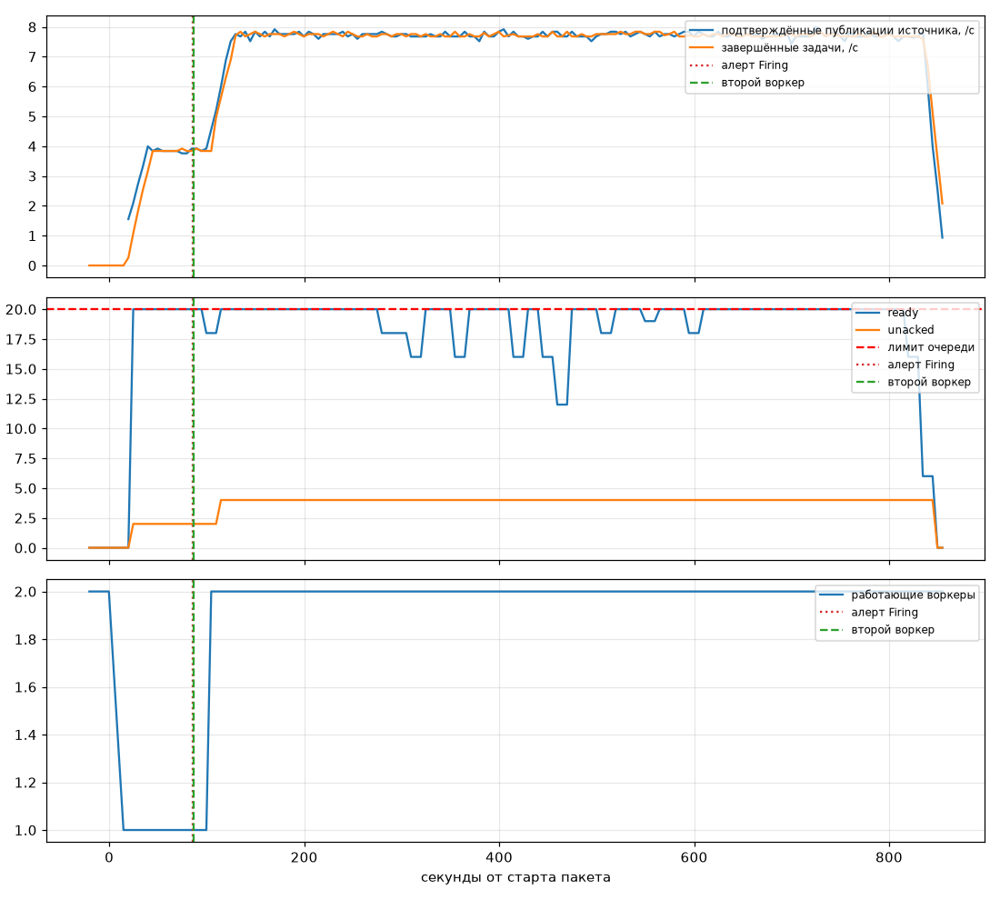

# Наблюдаемость конвейера

## Архитектура и выбор стека

```text
app, worker, batch-source ──OTLP HTTP──► Collector ──► Tempo (трейсы)
                                                  └──► Prometheus (метрики)
RabbitMQ :15692 ◄──scrape── Prometheus
stdout контейнеров ◄──Docker API── Alloy ──► Loki (логи)
Grafana: datasource metrics/logs/traces, dashboard pipeline, алерты
```

- Приложение знает только OTLP-адрес Collector. Хранилища можно заменить без
  изменения кода, а Collector ограничивает память и очередь экспорта.
- Метрики приходят push-ом: короткоживущий источник иначе не успел бы попасть
  под scrape. Глубину очереди честнее брать у самого брокера, поэтому RabbitMQ
  опрашивается pull-ом.
- Логи остаются JSON в stdout: приложение не зависит от Loki, Alloy читает их
  через Docker API.
- Связь сигналов идёт через `trace_id`: он есть в логе, в трейсе и в derived field
  Loki. `task_id` хранится в логах и атрибутах спанов, но не в labels метрик.

## Состав и профили Compose

`docker-compose.yaml` подключает `observability/compose.yaml` через `include`.
Обычный `docker compose up -d` запускает приложение без Grafana, хранилищ и
Collector. Профили включают стек по частям:

| Профиль | Компоненты |
| --- | --- |
| `logs` | Alloy и Loki |
| `traces` | Collector для трейсов и Tempo |
| `metrics` | Collector для метрик и Prometheus |
| `observability` | Все компоненты, единый Collector, Grafana |

```powershell
docker compose up -d
docker compose --profile logs up -d
docker compose --profile traces up -d
docker compose --profile metrics up -d
docker compose --profile traces --profile metrics up -d
docker compose --profile observability up -d
```

Trace-only и metrics-only профили используют отдельные конфигурации Collector,
чтобы не отправлять сигнал в отсутствующее хранилище. Профиль `observability`
использует конфигурацию с обоими pipeline. Профили `traces` и `metrics` можно
запускать вместе: сигналы отправляются по отдельным
OTLP endpoints. В профиле `observability` эти endpoints ведут к одному Collector.
Приложения не зависят через `depends_on` от стека наблюдаемости.

Для экспорта приложение должно получить `OTEL_SDK_DISABLED=false`; по умолчанию
SDK отключён, поэтому обычный запуск не зависит от Collector. Для профиля
`traces` оставить `OTEL_METRICS_EXPORTER=none`, а для `metrics` —
`OTEL_TRACES_EXPORTER=none`. В полном профиле включить оба экспортёра. Переменные
читаются процессом при старте, поэтому после изменения окружения пересоздать
приложения. В Compose traces отправляются на `otel-collector-traces:4318`, а
metrics — на `otel-collector-metrics:4318`. В полном профиле оба имени указывают
на combined Collector.

## Логи: Alloy → Loki

Alloy через Docker API читает stdout контейнеров текущего проекта, отобранных по
`com.docker.compose.project`; затем оставляет `app`, `worker` и `batch-source`.
В Loki индексируются только `service`, `level` и `env`. Идентификаторы задач и
трейсов остаются в JSON-строке, чтобы число потоков логов не росло с каждой
задачей. Сохраняются исходная запись приложения и её время. Позиция чтения Alloy
и данные Loki хранятся в именованных томах. Ротация Docker JSON-логов задана в
Compose.

Для короткоживущего `batch-source` Compose-команда оставляет контейнер работающим
на `BATCH_SOURCE_LOG_GRACE_S` до обработки и после неё. Паузы увеличивают окно
обнаружения и чтения, но не дают абсолютной гарантии доставки и требуют проверки
на живом стенде. Не запускать этот сервис с `--rm`: Docker должен сохранить
контейнер и его stdout для агента.

Пример запроса в Grafana Explore:

```logql
{service="hexrl-api"} | json | event="http_request_completed"
```

Поиск по задаче: добавить `| json | task_id="..."`. `docker.sock:ro` задаёт
read-only mount, но не ограничивает операции, разрешённые Docker API.

## Трейсы: OpenTelemetry → Collector → Tempo

SDK отправляет OTLP HTTP/protobuf на Collector. Он применяет `memory_limiter`
перед `batch`, ограничивает очередь и повторы экспорта, затем направляет спаны в
Tempo. У API, source и worker отдельные `service.name`; hostname контейнера
различает экземпляры воркера. Полный сбор трейсов выбран для учебной нагрузки.

Обычный Tempo config работает без Prometheus. Service Graph — дополнительный
режим из предыдущего этапа: он включается `TEMPO_CONFIG_FILE=service-graph.yaml`
только с профилем `observability`, где доступен Prometheus. Для standalone
`traces` оставить `TEMPO_CONFIG_FILE=config.yaml`.

## Метрики: OTLP и Prometheus

Приложения экспортируют метрики по OTLP через Collector в Prometheus OTLP
receiver. Для короткоживущего source push выбран, чтобы метрики успевали попасть
в хранилище даже без pull-опроса самого процесса. Глубину очереди и число
unacked сообщений Prometheus получает scrape-ом встроенного RabbitMQ
Prometheus-плагина на порту 15692. `QUEUE_PREFIX` ограничивает scrape очередями
текущего конвейера (`tasks`, `retry`, `dlq`), чтобы старые экспериментальные
префиксы не разрастались в Prometheus.

При OTLP-приёме Prometheus использует ограниченный набор resource attributes:
`service.name`, `service.instance.id`, `service.version` и
`deployment.environment.name`; произвольные resource attributes не продвигаются
в labels. Метрика лимита помечена именем очереди. Для неограниченной очереди
точка не экспортируется, поэтому линия лимита и алерт заполнения отсутствуют.

Оценка кардинальности, контракт метрик и причины выбора границ histogram
описаны ниже в разделе «Метрики»; это оценки, не измерение runtime-серий.

## Grafana provisioning и сигналы

Datasource UID заданы в provisioning: `metrics`, `logs`, `traces`. Dashboard,
правила алертов и источники находятся в репозитории и загружаются при старте
Grafana. Dashboard содержит выбор сервиса, экземпляра worker и очереди; очередь
для выбора берётся из метрики настроенного лимита. Перцентили вычисляются из
объединённых histogram buckets, счётчики отображаются через `rate` или
`increase`, панели задают единицы.

В Loki настроено derived field из JSON `trace_id` в Tempo. В Tempo настроен
запрос к Loki по тому же trace ID с временным запасом. Очередной алерт вычисляет
`ready / configured_limit` отдельно для каждой ограниченной очереди и срабатывает
при значении не ниже 0.9 в течение минуты. Строгое «больше» не подходит: prefetch
уводит сообщения из ready в unacked, а `x-max-length` считает только ready. Поэтому
насыщенная очередь с лимитом 20 показывает 18–20, и ровно 0.9 сбрасывал бы окно. DLQ alert срабатывает, пока в DLQ есть
сообщения, с выдержкой 10 секунд. NoData и ошибки запроса не считаются здоровым
состоянием. Наличие правила в provisioning само по себе не подтверждает его
срабатывание; для этого нужен сценарий на живом стенде.

## Ресурсы и известные ограничения проверки

Заданные Compose memory limits: Loki 256 MiB, Tempo 256 MiB, Prometheus 256 MiB,
Collector 192 MiB, Grafana 192 MiB, Alloy 128 MiB. Суммарный лимит — 1280 MiB.
Это верхняя конфигурационная сумма; измеренное потребление под нагрузкой —
в разделе «Измеренный бюджет памяти».

Версии образов закреплены, retention хранилищ по умолчанию 24 часа, данные и
позиции чтения находятся в именованных томах. Отсутствие Collector или хранилища
не является зависимостью приложения; SDK отключён по умолчанию. При включённом
экспорте краткий экспортный таймаут и ограниченные очереди уменьшают влияние
сбоев телеметрии, но при длительной недоступности backend часть телеметрии может
быть потеряна.
## Настройка

По умолчанию `OTEL_SDK_DISABLED=true`: экспортёры и их фоновые потоки не создаются.
Логи остаются JSON в stdout. API, источник и воркер имеют отдельные имена сервисов.
Для экспорта трейсов и метрик в доступный OpenTelemetry Collector задать в окружении процесса
или в env-файле контейнера:

```dotenv
OTEL_SDK_DISABLED=false
OTEL_EXPORTER_OTLP_ENDPOINT=http://otel-collector:4318
OTEL_EXPORTER_OTLP_PROTOCOL=http/protobuf
OTEL_EXPORTER_OTLP_TIMEOUT=0.5
OTEL_TRACES_SAMPLER=parentbased_always_on
OTEL_TRACES_EXPORTER=otlp
OTEL_METRICS_EXPORTER=otlp
OTEL_METRIC_EXPORT_INTERVAL=5000
OTEL_METRIC_EXPORT_TIMEOUT=1000
OTEL_RESOURCE_ATTRIBUTES=deployment.environment.name=development
LOG_LEVEL=INFO
```

Этот этап использует OTLP HTTP/protobuf. Адрес Collector должен разрешаться из
процесса отправителя: для запуска Python на хосте обычно нужен `localhost`,
для контейнера — сетевое имя Collector. Хранилища приложению неизвестны.
При запущенном профиле наблюдаемости имя `otel-collector` разрешается Compose-сетью.
`OTEL_TRACES_EXPORTER=none` или `OTEL_METRICS_EXPORTER=none` отключают отдельный
сигнал. `OTEL_EXPORTER_OTLP_TIMEOUT` — сетевой таймаут в секундах;
`OTEL_METRIC_EXPORT_INTERVAL` и `OTEL_METRIC_EXPORT_TIMEOUT` — миллисекунды.

`OTEL_SERVICE_NAME` переопределяет имя сервиса. Не задавать одно общее имя всем
сервисам: значения по умолчанию — `hexrl-api`, `hexrl-source`, `hexrl-worker`.
`service.version`, `deployment.environment.name` и `service.instance.id` можно
переопределить через `OTEL_RESOURCE_ATTRIBUTES`. По умолчанию версия берётся из
пакета, instance ID — hostname контейнера, поэтому реплики воркера различаются.

Переменные OTEL читаются из окружения. При локальном запуске `uv run` их нужно
экспортировать в PowerShell через `$env:...`; загрузка прикладных Settings из `.env`
не экспортирует их в окружение SDK. В Compose переменные поступают через `env_file`.

## Путь задачи

HTTP создаёт серверный спан. `task_id` передаётся в заголовке RabbitMQ и в
`correlation_id`, W3C `traceparent` переносит контекст. Стандартная
`RabbitTelemetryMiddleware` создаёт спаны публикации и обработки. Для batch source
каждая строка начинает отдельный `source.task`, а `batch_id` связывает пакет.
Весь файл не помещается в один трейс.

Ручные спаны:

- `db.create_task` — фиксация приёма HTTP-задачи;
- `source.wait` — пауза после отказа брокера;
- `inference` — чистый predict с `model.alias` и `model.version`;
- `db.save_result` — сохранение результата вместе с commit.

Искусственная задержка остаётся внутри обработки, но вне `inference`: на трейсе
можно отличить стоимость настоящей модели от имитации нагрузки. `copy_context()`
переносит OTel и контекст логов в каждый вызов ThreadPoolExecutor отдельно.
Номер попытки хранится в `messaging.delivery.attempt`, аварийная повторная доставка
отмечается атрибутом `messaging.message.redelivered`.

Повторы сохраняют trace ID через retry и TTL-пересылку. Ошибки отмечаются ERROR и
событием exception, перевод в DLQ — событием `task.dlq`. 503 также имеет ERROR-трейс.
Интервал между публикацией и обработкой виден по временной шкале; при измерении
его длительности необходимо учитывать синхронизацию часов разных процессов.

## Логи и защита данных

`task_context()` привязывает идентификаторы к текущему обработчику и очищает их
даже при исключении. Форматтер автоматически добавляет `task_id`, `batch_id`,
`trace_id`, `span_id`, когда соответствующий контекст существует. HTTP-запись об
ответе также содержит идентификатор созданной задачи, в том числе при 503.

Ошибки сохраняют тип исключения и кадры стека без исходной записи и значений
аргументов. Текст строк исходного кода в стек не включается: там тоже могут быть
чувствительные литералы. DSN и значения секретов из переменных окружения
маскируются. Не следует добавлять payload, конфиги или произвольный текст исключения
в события приложения. Успешные `/healthz` записываются только на DEBUG.
Логгеры `sqlalchemy` и `uvicorn.access` ограничены уровнем WARNING. Без этого общий
сброс уровней включал бы их на INFO: SQLAlchemy писал бы каждый запрос вместе с
параметрами, то есть с payload задачи, а access-лог дублировал бы
`http_request_completed` строкой без `trace_id`.

События включают загрузку модели с alias и версией, начало/конец обработки,
отказ публикации, backoff источника, ошибку с попыткой, DLQ и graceful shutdown.
Аналитические CSV старых нагрузочных скриптов пока сохранены для совместимости;
они не заменяют логи и не используются как хранилище телеметрии.

## Отказы телеметрии

Экспорт выполняется BatchSpanProcessor в отдельном потоке: очередь ограничена
128 спанами, размер пакета — до 128, интервал — 1 секунда. При переполнении спаны
теряются, а обработка задач продолжается. Экспорт ограничен коротким таймаутом.
При нормальном завершении SDK закрывается после завершения обработки и работы
с брокером; у короткоживущего источника также выполняется финальный экспорт.
После SIGKILL незавершённые спаны и буфер могут потеряться.

На стенде используется parent-based always-on, чтобы находить произвольные задачи.
При внешнем unsampled traceparent решение родителя сохраняется.
Tail sampling не используется.

## Метрики

Приложения отправляют метрики по OTLP HTTP/protobuf через Collector. Это важно
для короткоживущего источника: pull может не успеть его опросить. В начале источника
экспортируется нулевая точка, при нормальном завершении — финальные накопленные
значения. Оба вызова выполняются вне event loop с ограничением времени экспорта.
Периодический экспорт идёт в потоке SDK; обработчики не выполняют сетевые запросы
при увеличении счётчика. Используется cumulative temporality для Prometheus.

Контракт ниже использует имена OTLP. Prometheus добавляет суффиксы единиц и типов;
отображение имён зависит от конфигурации приёмника.

| Метрика | Тип и единица | Labels | Что измеряется |
| --- | --- | --- | --- |
| `hexrl.api.requests` | counter, 1 | method, route, status_code | Все ответы API, кроме healthz, включая 422, 503 и необработанные 500 |
| `hexrl.api.duration` | histogram, s | method, route, status_code | Длительность обработки HTTP-запроса |
| `hexrl.source.published` | counter, 1 | нет | Успешные публикации после confirm |
| `hexrl.source.rejections` | counter, 1 | reason | nack, timeout и unavailable отдельно |
| `hexrl.source.wait` | counter, s | нет | Фактически проведённое в backoff время, включая прерванную паузу |
| `hexrl.source.invalid` | counter, 1 | нет | Невалидные строки файла |
| `hexrl.worker.attempts` | counter, 1 | outcome | Исходы доставок: ok, error, dlq, duplicate, cancelled |
| `hexrl.worker.completed` | counter, 1 | нет | Новые результаты после commit, без дубликатов |
| `hexrl.worker.redeliveries` | counter, 1 | нет | Доставки с AMQP redelivered=true |
| `hexrl.worker.retries` | counter, 1 | нет | Подтверждённые публикации в retry |
| `hexrl.worker.dlq.publications` | counter, 1 | нет | Подтверждённые публикации в DLQ |
| `hexrl.worker.inflight` | gauge, 1 | нет | Активные обработчики сообщений |
| `hexrl.worker.predict.duration` | histogram, s | outcome | Чистый predict, включая ошибки |
| `hexrl.worker.delay.duration` | histogram, s | нет | Искусственная задержка, отдельно от predict |
| `hexrl.worker.processing.duration` | histogram, s | outcome | Время доставки в обработчике до выхода, с БД и подтверждениями |
| `hexrl.worker.task.duration` | histogram, s | нет | От submitted_at до фиксации нового успешного результата |
| `hexrl.worker.invalid.timestamps` | counter, 1 | нет | Отрицательная задержка или submitted_at без часового пояса |
| `hexrl.process.memory` | gauge, By | нет | RSS текущего процесса из psutil |
| `hexrl.process.running` | gauge, 1 | нет | 1 при работе, 0 в финальном экспорте перед остановкой SDK |
| `hexrl.queue.limit` | gauge, 1 | queue | Настроенный лимит у API/источника; для unbounded точка отсутствует |

Одна доставка может завершиться ошибкой и назначить retry: это увеличит attempts
с outcome=error и retries, но не completed. TTL-пересылка создаёт новую публикацию
и сама по себе не означает AMQP redelivered. Повторная публикация в DLQ считается
как публикация, а не как новая уникальная FAILED-задача.

`save_result()` уже возвращает признак новой вставки. Счётчик completed и histogram
task.duration обновляются только после commit такой вставки. Два параллельных
вычисления одной задачи дают один новый результат и две попытки. Метрики не атомарны
с БД: падение между commit и увеличением counter может недосчитать результат;
достоверная сверка уникальных задач по-прежнему выполняется по PostgreSQL.

In-flight уменьшается в finally при ошибке или отмене. Он показывает обработчики,
а не число занятых потоков: отмена await не прерывает уже выполняющийся predict.
Сама модель может закончить позже; shutdown пула ожидает её завершения.

Старый CSV source.wait_s_total сохраняет сумму назначенных пауз для совместимости.
Новая OTLP-метрика source.wait измеряет реальное время монотонными часами.
Timeout подтверждения не доказывает, что брокер отверг публикацию; reason=nack
выделяет настоящий отрицательный ответ отдельно от сетевых сбоев.

API использует разрешённый метод и шаблон сопоставленного маршрута. Неизвестные
адреса объединены в route=unmatched, неизвестные методы — method=OTHER.
task_id, batch_id, trace_id, версии моделей и текст ошибок в labels не добавляются.
Views дополнительно отбрасывают неожиданные ключи атрибутов. Автоматические метрики
FastStream отключены через DropAggregation; его трассировка остаётся включённой.

### Гистограммы и задержки

Predict имеет границы от 1 мс с детальными бакетами вокруг измеренных 2–3 мс.
HTTP имеет отдельные бакеты около дедлайнов 0.5/0.75/1 секунды. Для processing и
delay добавляются границы 0.5×, 1×, 1.1×, 2× и 4× INFERENCE_DELAY_S. Для долгих
проверок сохранены границы до 120 с. Полная задержка имеет бакеты до 300 с,
включая 10/15/30/60/120 с. Настройки применяются при запуске SDK.

Predict, delay и processing измеряются монотонными часами. Task duration связывает
время разных процессов и требует синхронизации часов. Отрицательные значения
не заменяются нулями: они пропускаются с увеличением invalid.timestamps.
Положительное значение само по себе не доказывает правильность синхронизации.
Histogram task.duration описывает только успешные задачи: проверка SLO должна
отдельно учитывать ошибки и выбранное окно/множество задач.

### Память и завершение источника

После нормального выхода source.running=0 позволяет не показывать последнее RSS
как память всё ещё работающего источника. После SIGKILL финального значения нет,
поэтому актуальность определяется свежестью последнего измерения. Push-модель
не предоставляет автоматически эквивалент Prometheus up для жизнеспособности процесса.
Приложение не публикует собственных оценок глубины очередей: источник
показателей ready/unacked/DLQ — встроенный Prometheus-плагин RabbitMQ.

### Оценка числа рядов

Для классической Prometheus histogram с K конечными границами получается K+3
ряда на сочетание labels: K бакетов, +Inf, sum и count. API имеет 12 конечных
границ: requests и duration вместе дают 16 рядов на сочетание method/route/status.
Если A — число сочетаний, верхняя оценка API — 16A+3 с runtime и queue.limit.
Грубая оценка A — произведение числа методов, маршрутов и статусов, а не число UUID.

При delay=0.5 один worker имеет до 183 рядов приложения после появления всех
допустимых исходов: 34 predict, 20 delay, 100 processing, 16 task duration,
10 counters и 3 gauges. Source — до 9 рядов при bounded queue. Например, при
A=10 и двух воркерах: 163+366+9=538 рядов. Это оценка инструментов приложения;
target_info, RabbitMQ и собственные метрики хранилищ считаются дополнительно.
`service.instance.id` по умолчанию равен hostname контейнера: перезапуск того же
контейнера сохраняет ряды, а новая реплика или пересоздание контейнера добавляют
новый набор рядов на время retention.

## Стенд защиты

Демонстрация использует обычный Compose-проект и `.env` из корня репозитория,
как и остальные сценарии приложения. Перед запуском убедиться, что переменные
окружения заполнены; отдельный `.env` и дублирующий стенд не нужны.

```powershell
uv sync --frozen --group dev --group experiments --group rl-cpu --group inference
uv run python -m scripts.observability.acceptance --clean
```

Acceptance и сценарии по умолчанию читают этот же `.env` и работают с проектом,
названным по корневой папке репозитория. Флаг `--clean` выполняет `down -v` перед
запуском, чтобы проверить provisioning с нуля. Он удаляет тома всего проекта,
включая PostgreSQL и MLflow registry. Без флага существующие данные сохраняются.

```powershell
docker compose --profile observability ps
```

Адреса Grafana, API, RabbitMQ Management и MLflow задаются переменными портов
в `.env` (по умолчанию 3000, 8000, 15672 и 5000).

| Переменная | Что открыть |
| --- | --- |
| `GRAFANA_PORT` | Grafana, dashboard `pipeline` |
| `APP_PORT` | API `/docs` |
| `RABBITMQ_MANAGEMENT_PORT` | RabbitMQ Management |
| `MLFLOW_PORT` | MLflow |

### Подготовка модели

`down -v` удаляет Registry и артефакты, поэтому модель готовит одноразовый сервис
`model-bootstrap` (`hexrl-bootstrap`, образ `Dockerfile.bootstrap`). Воркер зависит
от него через `service_completed_successfully`.

1. Если у `MODEL_NAME` есть alias `MODEL_ALIAS`, bootstrap загружает эту версию и
   делает predict. Так проверяется и alias, и доступность артефакта. Новая версия
   не создаётся.
2. Если alias нет, bootstrap генерирует реплеи, обучает настоящую DQN по
   `configs/navigation-dqn-smoke.toml`, регистрирует лучшую версию и назначает alias.
   Обучение запускается, только если конфиг регистрирует ту же пару
   `MODEL_NAME@MODEL_ALIAS`, которую загрузит воркер.
3. Входные файлы в `data/tasks` строятся под закреплённую версию модели и
   пересоздаются, только если отсутствуют или устарели: `smoke` (1000 строк),
   `defense` (6000), `invalid` (20 состояний вне карты).

Любая ошибка — ненулевой код выхода, и воркер не стартует. Alias без артефакта —
тоже ошибка, а не повод тихо обучить заново. Секреты в процесс не передаются:
у сервиса нет `env_file`, а печать ссылок MLflow в stdout отключена. В лог
попадают только имя модели, alias, версия и признак «обучена сейчас».

Воркер не объявляет готовность до загрузки модели: uvicorn начинает принимать
соединения только после lifespan, где модель загружается, поэтому `/healthz`
до этого не отвечает. На стенде чистый запуск с обучением занял 192 с, повторный
запуск с готовой моделью — 78 с.

### Приёмка и сценарии

`acceptance` выполняет чистый запуск: ждёт healthchecks и завершения bootstrap,
проверяет через API Grafana datasource, dashboard и правила алертов, отправляет
задачу и находит её лог, трейс и метрики. Отчёт пишется в JSON, при нарушении
любого требования код выхода ненулевой. Запросы к Prometheus, Loki и Tempo идут
через proxy Grafana, поэтому заодно проверяется работа datasource.

Сценарии защиты проверяют требования на живом стенде и тоже возвращают
ненулевой код при нарушении:

| Команда | Что проверяется |
| --- | --- |
| `scenarios load --dataset smoke --scale` | Короткий прогон для разработки, около 3 минут |
| `scenarios load --dataset defense --scale` | 6000 задач: переполнение, алерт, второй воркер, SLO |
| `scenarios errors` | Схема и доменная ошибка — сразу DLQ, сбой inference — повторы и DLQ |
| `scenarios lifecycle` | SIGTERM и SIGKILL под нагрузкой |
| `scenarios overload` | Серия 503 при заполненной очереди |
| `scenarios outage` | Остановка Collector, затем Loki |

Все запускаются как `uv run python -m scripts.observability.<имя>`. Отчёты и CSV
по умолчанию пишутся в `metrics/observability` и в Git не попадают. Итоговые
свидетельства сохранены в `docs/observability/results/2026-11-20`.

## Запросы для демонстрации

PromQL:

```promql
# заполнение рабочей очереди относительно лимита
max(rabbitmq_detailed_queue_messages_ready{queue=~".*[.]tasks"}
  / on(queue) max by (queue) (hexrl_queue_limit_ratio))
# одно окно: публикации источника, завершения, ready и unacked, экземпляры
sum(rate(hexrl_source_published_total[1m]))
sum(rate(hexrl_worker_completed_total[1m]))
sum(rabbitmq_detailed_queue_messages_ready{queue=~".*[.]tasks"})
sum(rabbitmq_detailed_queue_messages_unacked{queue=~".*[.]tasks"})
count(hexrl_process_running_ratio{job="hexrl-worker"} == 1)
# вклад каждого воркера
sum by (instance) (rate(hexrl_worker_completed_total[1m]))
# замедление источника
sum by (reason) (rate(hexrl_source_rejections_total[1m]))
# доля 503 среди приёма задач
sum(rate(hexrl_api_requests_total{status_code="503"}[5m]))
  / sum(rate(hexrl_api_requests_total{route="/api/v1/tasks", method="POST"}[5m]))
# SLO: доля успешных задач быстрее 10 секунд за окно
sum(increase(hexrl_worker_task_duration_seconds_bucket{le=~"10(\\.0)?"}[30m]))
  / sum(increase(hexrl_worker_task_duration_seconds_count[30m]))
# число рядов приложения
count({__name__=~"hexrl_.+"})
```

Gauge с единицей `1` в Prometheus получает суффикс `_ratio`:
`hexrl_queue_limit_ratio`, `hexrl_process_running_ratio`,
`hexrl_worker_inflight_ratio`. Граница `le` задана регулярным выражением: при
OTLP-приёме значение выглядит как `10`, а при scrape Prometheus 3 — как `10.0`.

LogQL:

```logql
{service=~"hexrl-.+"} |= "<task_id>"
{service=~".+"} | json | trace_id="<trace_id>"
{service="hexrl-worker", level="ERROR"} | json | event="task_processing_failed"
{service="hexrl-api"} | json | status_code="503"
{service="hexrl-bootstrap"} | json
```

TraceQL в Tempo:

```traceql
{name="source.wait"}
{resource.service.instance.id="<hostname воркера>" && name="inference"}
{resource.service.name="hexrl-api" && status=error}
```

По `task_id` находятся логи пути задачи. Опросы `GET /api/v1/tasks/{id}` — это
отдельные запросы со своими трейсами, их стоит отфильтровать (`method!="GET"`).
`trace_id` из лога открывает трейс, а из трейса Grafana возвращает в Loki по тому
же `trace_id`.

## Маршрут демонстрации

1. Compose-проект уже поднят и пройден acceptance. Показать отчёт: модель обучена при
   bootstrap, datasource, dashboard и правила подняты provisioning без ручной
   настройки.
2. Открыть dashboard `pipeline` и запустить
   `scenarios load --dataset defense --scale`. Источник упирается в лимит: ready
   достигает линии лимита, растут отказы брокера и время ожидания источника, в
   трейсах появляется `source.wait`.
3. Через минуту заполнения алерт `Queue near limit` переходит Pending → Firing.
   Скрипт добавляет второй воркер без изменения Grafana: на панели «Обработка по
   воркерам» появляется вторая легенда, в Tempo — второй `service.instance.id`,
   скорость завершений и подтверждённых публикаций растёт.
4. Взять любой `task_id` из Explore → Loki, перейти по `trace_id` в Tempo и
   показать вклад очереди (`publish` → `process`), inference и `db.save_result`.
5. `scenarios errors`: невалидная схема и состояние вне карты уходят в DLQ сразу,
   сбой inference даёт попытки 1–3 с ERROR в одном трейсе, затем DLQ. Алерт
   `DLQ contains messages` → Firing.
6. `scenarios lifecycle`, `scenarios overload`, `scenarios outage` — по ситуации,
   результаты ниже.

## Результаты на живом стенде

Измерено 2026-11-20: лимит очереди 20, `INFERENCE_DELAY_S=0.5`,
concurrency и prefetch по 2, retry 5 с, 3 попытки. Сводка и график лежат в
`docs/observability/results/2026-11-20`.

### Пакет 6000 задач и второй воркер

| Фаза | Окно | Завершения, /с | Подтверждённые публикации, /с |
| --- | --- | --- | --- |
| Один воркер | 72 с | 3.81 | 3.81 |
| Два воркера | 701 с | 7.72 | 7.73 |



Очередь заполнилась через 15 с, алерт перешёл в Firing через 86 с: минута
выдержки плюс интервалы scrape и оценки правила. Второй воркер добавлен сразу
после алерта, Grafana при этом не менялась. В трейсах два разных
`service.instance.id`, на панели «Обработка по воркерам» — вторая легенда.
Все 6000 строк завершились, в `inference_results` ровно 6000 строк, потерь и
дублей нет. Источник получил около 7600 отказов брокера и провёл в backoff 796 с,
вместо того чтобы переполнить очередь.

Установившаяся скорость считается по окну: от момента, когда ready впервые
достиг 90% лимита, до добавления второго воркера. Вторая фаза начинается через 30 с
после добавления и заканчивается за 10 с до выхода источника. Разгон и финальное
опустошение очереди в окна не входят. Скорость вычисляется через `increase()` по
каждой серии, поэтому появление ряда нового воркера и исчезновение рядов прошлых
процессов не искажают разность. Ускорение 2.03 — измеренный результат при
двух одинаковых воркерах и узком месте в inference. Это не гарантия: при упоре в
БД или брокер второй воркер дал бы меньше.

### SLO

Цель: 99% задач, принятых в очередь, завершаются успешно быстрее N = 10 с от
`submitted_at` до фиксации результата. Окно — один пакет или 30 минут работы.

Порог выбран после baseline. При насыщенной очереди задача ждёт примерно
`лимит / производительность`: 20 / 3.8 ≈ 5.3 с с одним воркером и ≈ 2.6 с с двумя,
плюс 0.5 с обработки. Для batch source `submitted_at` ставится до публикации,
поэтому сюда входит и ожидание в backoff источника. Измерено: один воркер —
p50 7.5 с, p95 9.75 с; два воркера — p95 4.9 с, p99 5.0 с. Значит, 10 с выдерживаются
с одним воркером почти без запаса, поэтому алерт заполнения и второй воркер нужны
именно для сохранения SLO. Граница 10 входит в buckets `hexrl.worker.task.duration`,
поэтому доля считается прямо по bucket `le="10"`, без интерполяции.

| Исход | Как считается | Пакет 6000 |
| --- | --- | --- |
| Хороший | bucket `le="10"` histogram task.duration | 6000 |
| Плохой: дедлайн превышен | count − bucket `le="10"` | 0 |
| Плохой: терминальная ошибка | задачи FAILED в PostgreSQL | 0 |
| Отдельно: отказ приёма | 503 среди POST и отказы брокера источнику | 7573 отказов источнику |

Знаменатель SLO — задачи, принятые в очередь. Отказы приёма в него не входят и
считаются отдельно. Для HTTP это доля 503 от `POST /api/v1/tasks`: клиент получил
отказ и `Retry-After`, а задача не создана. Для batch source отказ брокера — это
задержка, а не потеря: строка будет опубликована позже, и её ожидание уже входит
в end-to-end задержку. Длительность predict для SLO не используется — она не видит
очереди.

Error budget при 99% — 1% плохих исходов на согласованном окне: 60 задач на
пакет 6000. Пакет израсходовал 0 из 60. Histogram task.duration описывает только
успешные задачи, поэтому ошибки берутся из PostgreSQL или из
`hexrl_worker_attempts_total{outcome="dlq"}`, а не из той же histogram.

### Кардинальность на защите

Число рядов = произведение числа значений labels × число рядов одной метрики.
Для histogram с K границами это K + 3 ряда на сочетание: K bucket, +Inf, sum и
count. У `hexrl.worker.task.duration` 13 границ, значит 16 рядов на экземпляр
воркера. После пакета Prometheus показал 218 рядов `hexrl_*` на весь стенд: API,
источник и два воркера (`count({__name__=~"hexrl_.+"})`).

Если добавить label `task_id`, сочетаний станет столько же, сколько задач:
16 × 6000 = 96 000 рядов только для одной histogram после одного пакета, и каждый
новый пакет добавляет ещё столько же. Каждая серия получает одну точку и больше не
обновляется, но держит память и индекс Prometheus до конца retention. Поэтому
`task_id` живёт в логах и атрибутах спанов. Views пропускают в метрики только
`method`, `route`, `status_code`, `outcome`, `reason` и `queue`, а тест
`test_metrics` проверяет, что `task_id`, `batch_id` и `trace_id` в labels не
попадают.

### Семплирование

Полный parent-based always-on: на учебной нагрузке до 8 задач/с нужен трейс любой
произвольной задачи, включая успешные. За пакет 6000 задач Tempo занимал 113 MiB
при лимите 256 MiB. При росте нагрузки следующий шаг — tail sampling в Collector:
сохранять все трейсы с ERROR и долгие, а успешные брать долей.

### Ошибки, остановка и перегрузка

| Сценарий | Результат |
| --- | --- |
| Нарушенная схема | Сразу DLQ, `x-dead-reason=validation_error`, попытка 1 |
| Состояние вне карты | FAILED с первой попытки, DLQ без повторов |
| Сбой inference | Попытки 1, 2, 3 как ERROR в логах, один `trace_id`, затем DLQ; алерт DLQ → Firing |
| SIGTERM под нагрузкой | `worker_stopping` → взятые задачи доделаны и сохранены → `worker_stopped`; unacked 0, код выхода 0, финальный экспорт `running=0` |
| SIGKILL под нагрузкой | Задачи в PROCESSING вернулись брокеру; новый процесс увидел 2 redelivery; 1000 задач завершены ровно по одному разу |
| Заполненная очередь без воркера | Из 60 POST 20 приняты, 40 получили 503 с `Retry-After: 1`; PENDING не осталось; ERROR-трейс и лог 503 связаны `trace_id` |

После SIGKILL буфер телеметрии убитого процесса теряется: финального `running=0`
нет, и устаревшее значение уходит из запросов только по lookback Prometheus.

### Отказ хранилищ телеметрии

Collector и Loki останавливались по очереди, во время остановки отправлялось
40 задач.

| Остановлен | Задачи | Задержка приёма, макс. | Рост памяти app / worker | Потери |
| --- | --- | --- | --- | --- |
| Collector | 40 из 40 завершены | 37 мс | +0.7 / +3.5 MiB | Трейсы окна потеряны: 0 найдено |
| Loki | 40 из 40 завершены | 17 мс | ≈ 0 | Логи всех 40 задач дошли после восстановления |

Очереди и результаты не зависят от хранилищ телеметрии. Экспорт SDK завершается
по таймауту 0.5 с, очередь спанов ограничена 128, при переполнении спаны
отбрасываются, и память приложения не растёт. После возврата Collector новые
трейсы и метрики появились снова. Alloy досылает логи после короткого отказа
Loki, но число повторов ограничено: при длительном отказе логи тоже будут
потеряны. Бесконечная сохранность телеметрии не гарантируется — это осознанный
обмен на то, что приложение не тормозит и не падает.

### Измеренный бюджет памяти

`docker stats` под нагрузкой: пакет 6000, два воркера, 240 с от старта.

| Компонент | Использовано, MiB | Лимит, MiB |
| --- | --- | --- |
| Tempo | 113 | 256 |
| Loki | 110 | 256 |
| Collector | 103 | 192 |
| Grafana | 83 | 192 |
| Alloy | 68 | 128 |
| Prometheus | 49 | 256 |
| Наблюдаемость всего | 526 | 1280 |

Приложение под той же нагрузкой: app 82 MiB, два воркера 742 MiB вместе, RabbitMQ
192 MiB. Наблюдаемость укладывается в заявленный бюджет 1280 MiB с запасом более
чем вдвое. Отдельно заметен MLflow-сервер — 2.2 GiB, но он не входит в стек
наблюдаемости и под нагрузкой не участвует.

Стек наблюдаемости выключается: обычный `docker compose up -d` без профиля его не
запускает, а `OTEL_SDK_DISABLED=true` (по умолчанию в `.env.example`) не создаёт
экспортёров.

## Проверки

```powershell
uv sync --frozen --group experiments --group rl-cpu --group inference
uv run --no-sync ruff check .
uv run --no-sync ruff format --check .
uv run --no-sync ty check
uv run --no-sync pytest
uv run --no-sync pytest -m integration tests/integration
```

Обычные тесты проверяют изоляцию параллельных задач, родителя inference в потоке,
очистку контекста после ошибки, отдельные трейсы строк файла, backoff, маскировку,
реальный OTLP HTTP/protobuf экспорт и работу без Collector. Интеграционные тесты
дополнительно проверяют путь HTTP → настоящий RabbitMQ → поток → БД, а также
сохранение traceparent через настоящую retry-очередь до DLQ, включая сбой публикации.

Быстрые проверки не поднимают полный стек. Unit-тесты дополнительно проверяют
идемпотентный bootstrap и отказ при alias без артефакта, нулевые точки счётчиков,
`service.instance.id` по hostname, отсутствие SQL-параметров и access-строк в
INFO-логах, а также разбор ответов Compose, Tempo и `docker stats`. Приём сигналов
хранилищами, Grafana provisioning и сценарии защиты проверяются отдельно, на
живом стенде, командами `acceptance` и `scenarios`.
